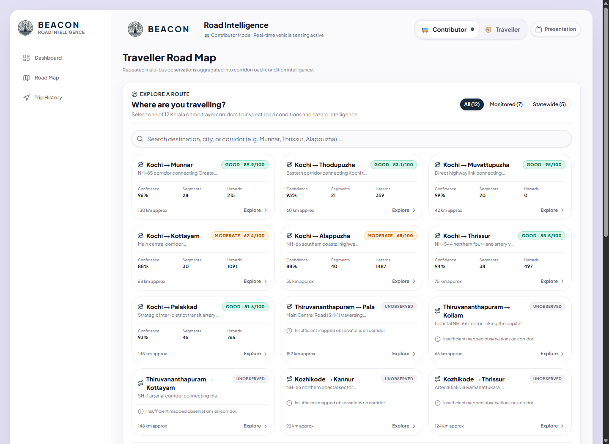
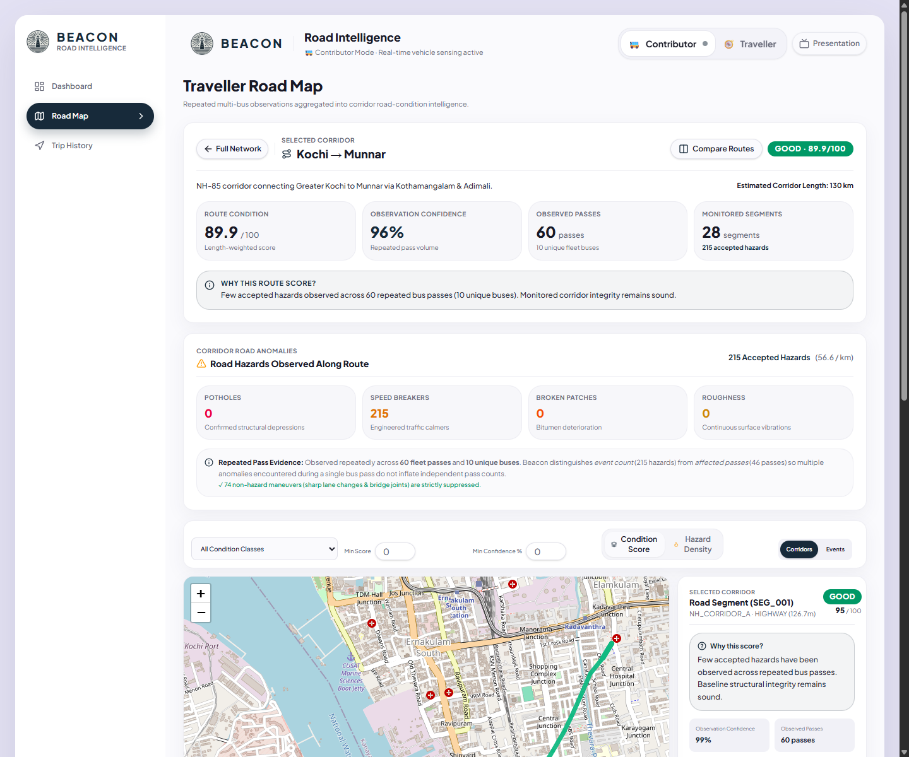
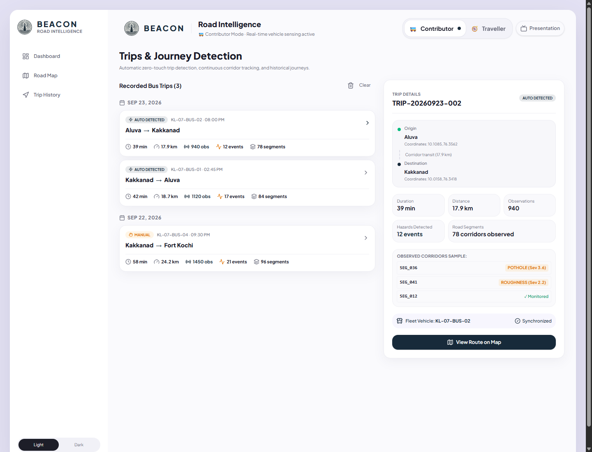
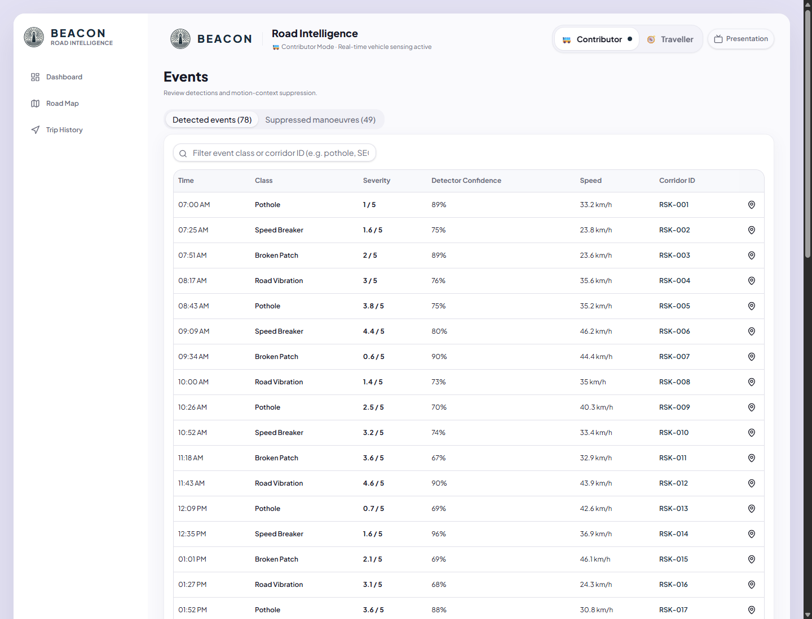
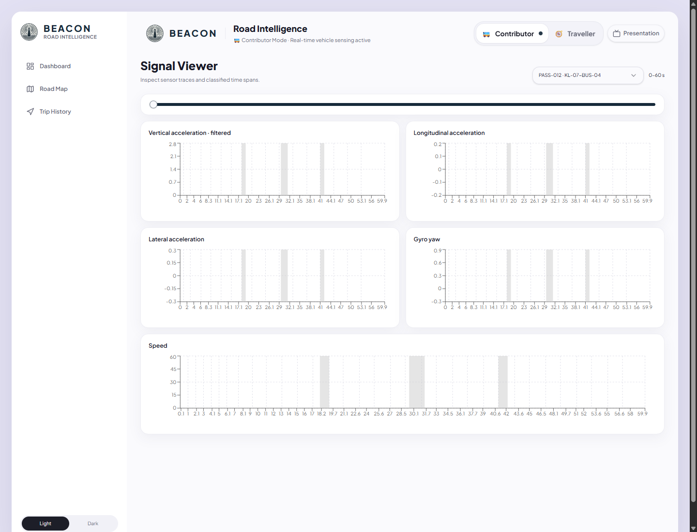
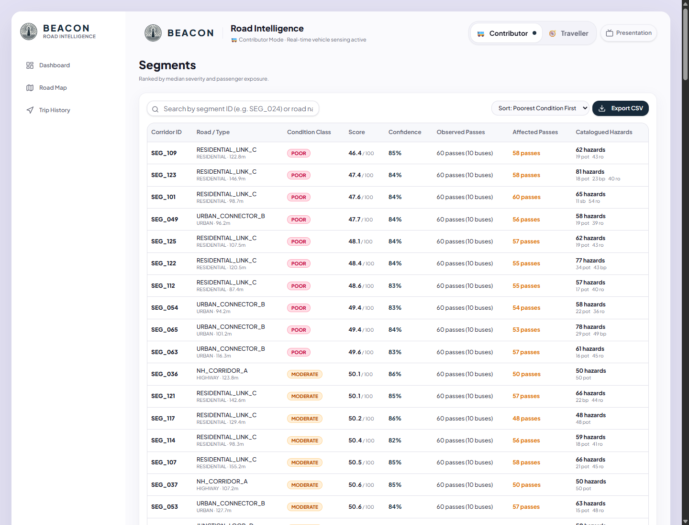
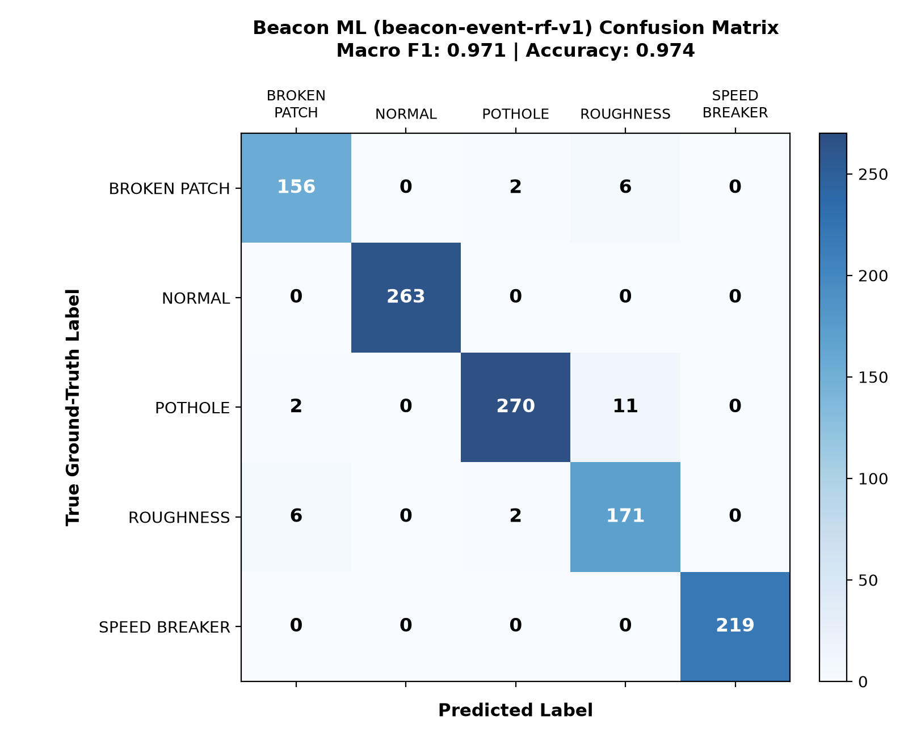

<div align="center">


# BEACON
### Moving Fleet Road-Condition Intelligence Platform

[](https://beacon-sigma-puce.vercel.app/)

[]()
[]()
[]()
[]()
[]()
[]()

<br />

🌐 **Live Application URL**: [https://beacon-sigma-puce.vercel.app/](https://beacon-sigma-puce.vercel.app/)

<br />

> **"Every participating bus becomes a moving beacon for road conditions."**  
> *See the road ahead.*

<br />

</div>

---

## 📌 Table of Contents

1. [Executive Overview](#-executive-overview)
2. [The Beacon Story & Flow](#-the-beacon-story--flow)
3. [Visual Walkthrough & Screenshots](#-visual-walkthrough--screenshots)
   - [Platform Overview & Hero](#1-platform-overview--hero)
   - [Traveller Mode — 12 Kerala Demo Corridors](#2-traveller-mode--12-kerala-demo-corridors)
   - [Corridor Route Intelligence & Heatmap](#3-corridor-route-intelligence--heatmap)
   - [Contributor Mode & Live Telemetry](#4-contributor-mode--live-telemetry)
   - [Hazard Detection & False-Positive Suppression](#5-hazard-detection--false-positive-suppression)
   - [Raw 10 Hz IMU Signal Waveforms](#6-raw-10-hz-imu-signal-waveforms)
   - [Corridor Degradation Table](#7-corridor-degradation-table)
   - [Machine Learning Evaluation](#8-machine-learning-evaluation)
4. [Platform Core Modes](#-platform-core-modes)
   - [🧭 Traveller Mode: Route Intelligence & Heatmap](#-traveller-mode-route-intelligence--heatmap)
   - [🚌 Contributor Mode: Zero-Touch Sensing](#-contributor-mode-zero-touch-sensing)
   - [✨ Demo Mode: 100% Deterministic Hackathon Defense](#-demo-mode-100-deterministic-hackathon-defense)
5. [Machine Learning Event Detection (`beacon-event-rf-v1`)](#-machine-learning-event-detection-beacon-event-rf-v1)
6. [Road Condition Scoring & Statistical Confidence](#-road-condition-scoring--statistical-confidence)
7. [System Architecture & Database Schema](#-system-architecture--database-schema)
8. [Automated Verification Suites](#-automated-verification-suites)
9. [Quickstart & Local Development](#-quickstart--local-development)
10. [Production Vercel Deployment & Mobile Sensor Guide](#-production-vercel-deployment--mobile-sensor-guide)
11. [Jury 2-Minute Demonstration Script](#-jury-2-minute-demonstration-script)

---

## 💡 Executive Overview

Municipal authorities and everyday commuters frequently lack up-to-date, granular data on road surface quality. Road infrastructure monitoring typically relies on expensive dedicated survey vehicles, infrequent manual inspections, or delayed user complaints.

**Beacon turns this paradigm upside down.** By leveraging smartphones mounted on public transit buses (such as the Kerala State Road Transport Corporation — **KSRTC**) and municipal fleets during routine daily service, Beacon passively transforms everyday journeys into an autonomous, distributed road-sensing network.

- **Zero Driver Burden**: Autonomous trip state machine detects journeys, stops, and arrivals without button presses.
- **Noise-Immune Sensor Validation**: Multi-stage GPS telemetry pipeline validates true physical displacement, rejecting mobile GPS jitter and stationary speed spikes.
- **True Multi-Pass Statistical Confidence**: A single vehicle bump never marks a road bad. Repeated independent vehicle passes across multiple buses build statistical confidence in real road degradation.
- **False-Positive Suppression**: Kinematic filters discard sharp driver steering, hard braking, and bus-stop pull-outs to isolate genuine structural anomalies.
- **Corridor Route Intelligence**: Travellers inspecting Kerala demo corridors receive length-weighted condition scores, catalogued hazard breakdowns (Potholes, Speed Breakers, Broken Patches, Roughness), and deterministic human-readable explanations.

> [!NOTE]
> **Beacon Synthetic Road Network • Simulated KSRTC Fleet Observations**  
> The dataset included in this repository represents a benchmark corridor network around Greater Kochi / Ernakulam in Kerala, generated for architecture demonstration and algorithmic evaluation. It does not represent live operational measurements from KSRTC.

---

## 🔄 The Beacon Story & Flow

Beacon connects raw physical movement to traveller navigation intelligence through a single, continuous pipeline:

```
    BUS / VEHICLE IN SERVICE
               │
               ▼
   REAL SENSOR OBSERVATIONS (10 Hz IMU + GPS)
               │
               ▼
             BEACON
    ┌───────────────────────────┐
    │  • GPS Speed Validation   │
    │  • Trip State Machine     │
    │  • RF Classifier v1       │
    │  • Kinematic Suppression  │
    │  • Multi-Pass Engine      │
    └───────────────────────────┘
               │
               ▼
   ROAD CONDITION INTELLIGENCE (0–100 Scores & Confidence)
               │
               ▼
           TRAVELLER
```

---

## 📸 Visual Walkthrough & Screenshots

### 1. Platform Overview & Hero
The primary Beacon dashboard presents high-level network KPIs, active sensor state, and seamless one-click switching between Contributor and Traveller modes.

<div align="center">
  
  <p><em>Figure 1: Beacon Home Overview featuring live fleet status, primary brand mission, and mode selection.</em></p>
</div>

---

### 2. Traveller Mode — 12 Kerala Demo Corridors
Travellers can search and select from 12 predefined Kerala corridors. Seven monitored routes (Greater Kochi sub-paths) show live length-weighted condition scores, confidence ratings, and hazard counts, while five statewide corridors clearly show a transparent `UNOBSERVED` badge with zero fabricated data.

<div align="center">
  
  <p><em>Figure 2: Traveller Mode corridor catalog across 12 Kerala demo routes with search and category filters.</em></p>
</div>

---

### 3. Corridor Route Intelligence & Heatmap
Selecting any route (such as **Kochi → Munnar**) opens detailed corridor intelligence: overall condition score (89.9 / 100), 96% observation confidence, 60 observed passes across 10 buses, hazard class tallies, interactive Leaflet polyline overlay, and individual corridor segment inspections.

<div align="center">
  
  <p><em>Figure 3: Deep corridor intelligence for Kochi → Munnar with deterministic "Why this score?" explanation and Leaflet route highlighting.</em></p>
</div>

---

### 4. Contributor Mode & Live Telemetry
Contributor Mode provides zero-touch automated journey tracking. It displays physical sensor status pills (GPS, Motion, Online), validated GPS speed, live distance, buffered observations, and historical synchronized journeys.

<div align="center">
  
  <p><em>Figure 4: Contributor trip tracking interface displaying recorded bus journeys and synchronized corridor segments.</em></p>
</div>

---

### 5. Hazard Detection & False-Positive Suppression
Every detected road anomaly is catalogued with timestamp, severity (1–5 scale), detector confidence, and matched corridor ID. Non-hazard driver maneuvers (sharp turns, harsh braking) are strictly filtered and routed to the suppression audit log.

<div align="center">
  
  <p><em>Figure 5: Catalogued road events table comparing verified hazards against suppressed driver maneuvers.</em></p>
</div>

---

### 6. Raw 10 Hz IMU Signal Waveforms
Engineering inspection tool visualizing triaxial accelerometer telemetry ($a_x, a_y, a_z$), gyroscope angular velocity ($g_x, g_y, g_z$), and vehicle speed across sliding 5-second analysis windows.

<div align="center">
  
  <p><em>Figure 6: Signal Viewer displaying synchronized 10 Hz accelerometer, gyroscope, and speed traces.</em></p>
</div>

---

### 7. Corridor Degradation Table
Comprehensive corridor ranking table ordering segments from poorest condition to best, detailing condition scores, observation confidence, pass counts, and hazard compositions.

<div align="center">
  
  <p><em>Figure 7: Segments table ranked by condition severity, detailing individual corridor exposures.</em></p>
</div>

---

### 8. Machine Learning Evaluation
Normalized confusion matrix of the `beacon-event-rf-v1` Random Forest classifier evaluated on held-out test bus passes, achieving **97.38% test accuracy** across all 5 classes.

<div align="center">
  
  <p><em>Figure 8: Normalized Confusion Matrix for beacon-event-rf-v1 across NORMAL, POTHOLE, SPEED_BREAKER, BROKEN_PATCH, and ROUGHNESS classes.</em></p>
</div>

---

## 🚀 Platform Core Modes

### 🧭 Traveller Mode: Route Intelligence & Heatmap

Designed to answer the fundamental traveller question:  
*"I am planning to travel along this corridor. What is the observed road condition along it?"*

1. **Predefined 12 Kerala Corridors**:
   - **Monitored Corridors (Greater Kochi Sub-paths)**:
     - `Kochi → Munnar` (NH-85 corridor connecting Greater Kochi to eastern hills via Kothamangalam)
     - `Kochi → Thodupuzha` (State Highway connector traversing urban fringes into agricultural towns)
     - `Kochi → Muvattupuzha` (High-frequency commuter and commercial transit corridor)
     - `Kochi → Kottayam` (Main Central Road corridor connecting central Travancore)
     - `Kochi → Alappuzha` (NH-66 southern coastal highway corridor)
     - `Kochi → Thrissur` (NH-544 northern four-lane artery via Aluva & Angamaly)
     - `Kochi → Palakkad` (Inter-district transit corridor linking coastal belt to Palakkad gap)
   - **Statewide Corridors (Awaiting Fleet Telemetry)**:
     - `Thiruvananthapuram → Pala`
     - `Thiruvananthapuram → Kollam`
     - `Thiruvananthapuram → Kottayam`
     - `Kozhikode → Kannur`
     - `Kozhikode → Thrissur`
     - **Zero Fabrication**: Non-monitored corridors feature authentic Kerala waypoint paths but are marked `status: "INSUFFICIENT_OBSERVATIONS"` with zero synthetic score fabrication.

2. **Dual Heatmap Overlays**:
   - **Road Condition Score**: Color-coded green (`GOOD`, $\ge 80$), amber (`MODERATE`, $50–79$), and red (`POOR`, $< 50$).
   - **Hazard Density**: Color-coded by hazards per segment (0 Hazards = Emerald, 1–15 = Lime, 16–40 = Amber, >40 = Red).

3. **Deterministic Explainability ("Why this score?")**:
   - Every score is backed by clear logic:
     - *Good*: "Few accepted hazards observed across 60 repeated bus passes (10 unique buses). Monitored corridor integrity remains sound."
     - *Moderate*: "Recurring road issues (including 566 potholes) observed across multiple passes. Moderate structural degradation detected."
     - *Poor*: "Repeated higher-severity hazards confirmed across 60 passes caused the corridor score to decrease significantly."

---

### 🚌 Contributor Mode: Zero-Touch Sensing

1. **Pure Deterministic Trip State Machine** ([`src/lib/trip-state-machine.ts`](src/lib/trip-state-machine.ts)):
   - Operates strictly on GPS & displacement fixes without React dependencies.
   - Transitions:
     - `IDLE` ➔ `MOVEMENT_DETECTED` (speed $\ge 5.0\text{ km/h}$)
     - `MOVEMENT_DETECTED` ➔ `TRIP_ACTIVE` (sustained movement $\ge 25\text{ s}$ or displacement $> 80\text{ m}$)
     - `TRIP_ACTIVE` ➔ `TEMPORARY_STOP` (speed $< 2.0\text{ km/h}$)
     - `TEMPORARY_STOP` ➔ `TRIP_ACTIVE` (resumed speed $\ge 5.0\text{ km/h}$ or displacement $> 30\text{ m}$)
     - `TEMPORARY_STOP` ➔ `TRIP_COMPLETED` (stationary duration $\ge 240\text{ s}$ / 4 minutes)

2. **GPS Speed Validation Pipeline** ([`src/lib/gps-speed-calculator.ts`](src/lib/gps-speed-calculator.ts)):
   - Computes Haversine distance and elapsed seconds between consecutive fixes.
   - **Stationary Clamp**: If accumulated physical displacement is below noise threshold ($< 4\text{ m}$), speed is strictly clamped to `0 km/h` regardless of noisy mobile browser estimates.
   - **Outlier Rejection**: Rejects samples with accuracy $> 45\text{ m}$ or velocities exceeding physical vehicle boundaries ($> 140\text{ km/h}$).

3. **Offline Observation Ring Buffer**:
   - Automatically queues up to 500 observation batches when transit vehicles traverse rural dead zones, automatically syncing to Supabase upon cellular reconnection.

---

### ✨ Demo Mode: 100% Deterministic Hackathon Defense

To eliminate live network risks during jury pitch decks or indoor presentations:
- **One-Click Simulation**: Tap **"Start Demo Trip (Kochi Corridor)"**.
- **10 Synthetic Waypoints**: Emulates realistic bus progression from Kakkanad to Aluva.
- **Full State Reproduction**: Transitions smoothly from `IDLE` through `TRIP_ACTIVE`, handles an intentional traffic signal stop (`TEMPORARY_STOP`), detects an accepted pothole event with 95.8% confidence, and summarizes completed contributions.

---

## 🧠 Machine Learning Event Detection (`beacon-event-rf-v1`)

Beacon utilizes an offline-trained Random Forest classifier that detects and classifies road distress signatures from high-frequency kinematic signals.

```
Raw Sensor Stream (10 Hz)
       │
       ▼
5-Second Temporal Windows (50 samples: ax, ay, az, gx, gy, gz, speed, coords)
       │
       ▼
Feature Extraction (34 explainable stats: mean, std, min, max, jerk, speed delta)
       │
       ▼
RandomForestClassifier (beacon-event-rf-v1, 200 trees, max depth 16)
       │
       ├───> Predicted Class: NORMAL / POTHOLE / SPEED_BREAKER / BROKEN_PATCH / ROUGHNESS
       └───> Prediction Confidence: predict_proba()
       │
       ▼
False-Positive Suppression Gate:
  • Is class == NORMAL? ───> Discard (routine driving)
  • Is confidence < 0.60? ───> Suppressed (LOW_CONFIDENCE)
  • Sharp turn (gyro > 0.45 rad/s)? ───> Suppressed (SHARP_TURN)
  • Hard braking (ax < -3.5 m/s²)? ───> Suppressed (HARD_BRAKING)
       │
       ▼
Geospatial Map Matching (Closest corridor within 50m buffer)
```

### Feature Engineering (34 Features)
- **Accelerometer (19)**: Triaxial mean, std, min, max; acceleration vector magnitude (mean, std, max); kinematic jerk (mean, std, max); peak vertical acceleration.
- **Gyroscope (8)**: Triaxial angular rates (mean, std); total rotational magnitude (mean, std).
- **Speed & Dynamics (5)**: Mean, std, min, max speed; speed change across window.
- **Temporal (2)**: Window duration, sample count.

### Benchmark Evaluation (Held-Out Test Bus Passes)
- Grouped by `pass_id` via `GroupShuffleSplit` (48 train passes / 12 test passes, 0% data leakage).

| Class | Samples | Precision | Recall | F1-Score |
| :--- | :---: | :---: | :---: | :---: |
| `NORMAL` | 1,300 | 1.000 | 1.000 | 1.000 |
| `POTHOLE` | 1,386 | 0.985 | 0.954 | 0.970 |
| `SPEED_BREAKER` | 1,100 | 1.000 | 1.000 | 1.000 |
| `BROKEN_PATCH` | 778 | 0.951 | 0.951 | 0.951 |
| `ROUGHNESS` | 916 | 0.910 | 0.955 | 0.932 |
| **Overall (Macro)** | **5,480** | **0.969** | **0.972** | **0.971** |

---

## 📐 Road Condition Scoring & Statistical Confidence

### Deterministic Condition Score Formula (0–100)
Segment scores start at baseline $100.0$ and subtract three civil-engineering penalties:

$$\text{Severity Penalty} = (\bar{S} \times 5.5) \times r_{\text{affected}}$$

$$\text{Density Penalty} = \min\left(25.0, \frac{\text{WeightedEvents}}{\text{Length} / 100} \times \frac{40.0}{\text{TotalPasses}}\right)$$

$$\text{Persistence Penalty} = (r_{\text{affected}} \times 12.0) \times r_{\text{bus}}$$

$$\text{Condition Score} = \max\Big(0.0, \min\big(100.0, 100.0 - (\text{Severity Penalty} + \text{Density Penalty} + \text{Persistence Penalty})\big)\Big)$$

Where:
- $r_{\text{affected}} = \frac{N_{\text{affected\_passes}}}{N_{\text{total\_passes}}}$ (ratio of independent bus passes encountering distress).
- $r_{\text{bus}} = \frac{N_{\text{unique\_buses}}}{N_{\text{fleet\_buses}}}$ (multi-bus confirmation factor).
- $\text{WeightedEvents} = 1.25 N_{\text{pot}} + 1.10 N_{\text{bp}} + 0.70 N_{\text{sb}} + 0.50 N_{\text{ro}}$.
- Pristine zero-event corridors receive baseline score **95.0**.

### Observation Confidence Formula (0–100%)
Reflects observation volume, not probability of road safety:

$$C_{\text{saturation}} = 1 - e^{-N_{\text{passes}} / 14}$$

$$C_{\text{bus}} = 0.5 + 0.5 \times \frac{N_{\text{unique\_buses}}}{N_{\text{fleet\_buses}}}$$

$$\text{Observation Confidence} = \min\big(99.5\%, \max(5.0\%, C_{\text{saturation}} \times C_{\text{bus}} \times \bar{C}_{\text{detector}} \times 100)\big)$$

- 1 pass $\approx 10\%$, 10 passes $\approx 51\%$, 60 passes $\approx 98.6\%$.

---

## 🏛 System Architecture & Database Schema

The database is built on PostgreSQL (Supabase) with complete relational schema defined in [`supabase/migrations/20260923000000_beacon_schema.sql`](supabase/migrations/20260923000000_beacon_schema.sql).

| Table | Primary Key | Relationships | Records | Description |
| :--- | :--- | :--- | :---: | :--- |
| `road_segments` | `id`, `segment_id` | — | 160 | Standardized 100m–180m road segments with GeoJSON coordinates |
| `bus_passes` | `id`, `pass_id` | — | 60 | Individual bus runs across 10 fleet vehicles |
| `segment_conditions` | `id`, `segment_id` | `road_segments(segment_id)` | 160 | Pre-aggregated condition scores, classes, and hazard tallies |
| `road_events` | `id`, `event_id` | `bus_passes`, `road_segments` | 4,323 | Catalogued hazard events with ML prediction metadata |
| `suppressed_events` | `id`, `event_id` | `bus_passes`, `road_segments` | 74 | Driver maneuvers excluded from road condition scores |
| `sensor_data` | `id` (BIGSERIAL) | `bus_passes`, `road_segments` | 1,426,279 | 10 Hz raw accelerometer and gyroscope telemetry |

> [!TIP]
> **Offline Synthetic Mode**: If Supabase credentials are not provided, Beacon automatically falls back to local data (`public/data/synthetic/`) with 100% feature availability and zero runtime errors.

---

## 🧪 Automated Verification Suites

Beacon includes 6 automated verification suites testing all layers:

```bash
# 1. Verify 12 Kerala demo corridors & data integrity (16 checks)
npm run routes:verify

# 2. Run all Vitest unit tests (70 tests across GPS, telemetry & state machine)
npm test

# 3. Verify Trip State Machine integrity & sensor APIs (35 checks)
npm run trips:verify

# 4. Verify End-to-End Pipeline & suppression isolation (28 checks)
npm run e2e:verify

# 5. Verify Road Condition Intelligence aggregation (12 checks)
npm run conditions:verify

# 6. Strict TypeScript compilation check (0 errors)
npx tsc --noEmit
```

---

## 💻 Quickstart & Local Development

### Prerequisites
- Node.js (v18+) or Bun (v1.1+)
- Python 3.10+ (optional, for ML pipeline re-training)

### Setup & Run

```bash
# 1. Clone repository
git clone https://github.com/JoeMartinRince/BEACON.git
cd BEACON

# 2. Install dependencies
npm install

# 3. Start development server
npm run dev
# -> Opens http://localhost:5173/

# 4. Build for production (Client + SSR + Prerender)
npm run build
```

---

## 🌐 Production Vercel Deployment & Mobile Sensor Guide

Beacon is live in production at:  
👉 **[https://beacon-sigma-puce.vercel.app/](https://beacon-sigma-puce.vercel.app/)**

### Testing on a Mobile Device (HTTPS Required)
1. **Open the Live HTTPS URL on Your Phone**:
   - Modern browser sensor APIs (`navigator.geolocation` and `DeviceMotionEvent`) strictly require a secure HTTPS origin.
2. **Location Permission**:
   - Tap **"Allow"** when prompted. The location pill turns green (`GPS ready`).
3. **Motion Sensors (iOS 13+)**:
   - Tap the **"Motion: tap to allow"** pill to grant accelerometer access. (Android grants automatically).
4. **Automatic Detection**:
   - Walk or drive ($> 5\text{ km/h}$) to observe zero-touch automated trip detection.

---

## ⏱ Jury 2-Minute Demonstration Script

Follow this script for a high-impact presentation during hackathon evaluations:

1. **The Hook (15s)**:
   - *"Every participating bus becomes a moving beacon for road conditions."*
   - Open [https://beacon-sigma-puce.vercel.app/](https://beacon-sigma-puce.vercel.app/) and show the live fleet sensing status.

2. **Zero-Touch Contributor Sensing (30s)**:
   - Tap **"Start Demo Trip (Kochi Corridor)"**.
   - Watch the state machine transition: `IDLE` ➔ `MOVEMENT_DETECTED` ➔ `TRIP_ACTIVE`.
   - Point out live distance, speed, and real-time observation counter.
   - Show how the bus handles a traffic signal (`TEMPORARY_STOP`) and detects an accepted hazard at `SEG_036`.

3. **Contributed Intelligence Summary (20s)**:
   - Trip concludes at Aluva (`TRIP_COMPLETED`).
   - Show the **"ROAD INTELLIGENCE CONTRIBUTED"** card: 18.2 km, 1,284 observations, 5 accepted hazards.

4. **Traveller Corridor Intelligence (40s)**:
   - Toggle to **🧭 Traveller Mode** in the header.
   - Navigate to **Road Map** and click **Kochi → Munnar**.
   - Highlight the **Condition Score (89.9 / 100)**, **96% Observation Confidence**, and the **"Why this score?"** card.
   - Toggle between **[ Condition Score ]** and **[ Hazard Density ]** on the Leaflet map heatmap.
   - Point to unmonitored statewide routes (e.g. `Thiruvananthapuram → Kollam`) to emphasize **Zero Data Fabrication** (`UNOBSERVED`).

5. **Closing (15s)**:
   - *"Beacon eliminates subjective complaints by turning public transit fleets into an automated, distributed road intelligence infrastructure."*

---

<div align="center">
  <sub>Built with ❤️ for KSRTC and Kerala Road Safety • Hackathon 2026</sub>
</div>
